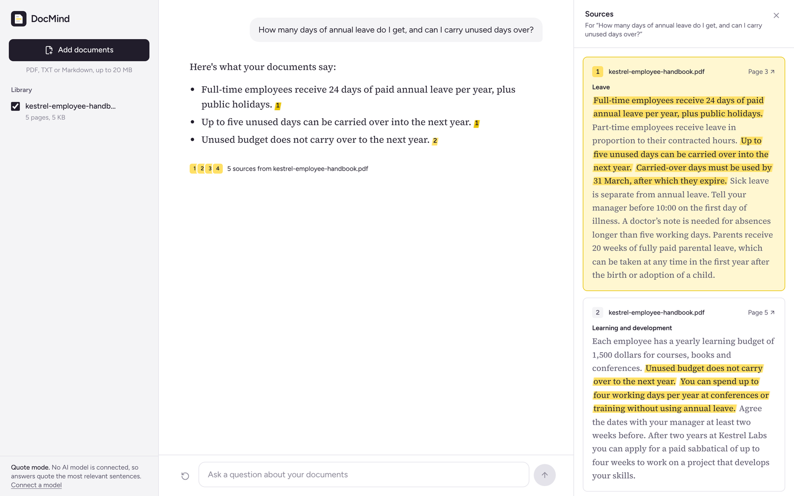
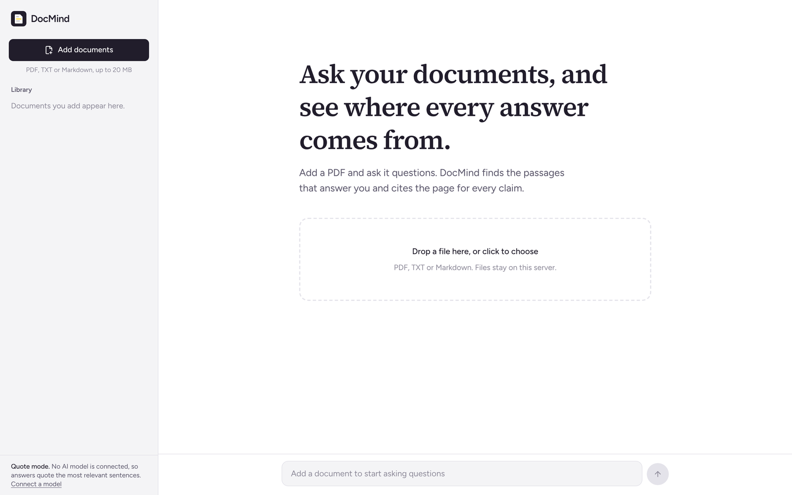
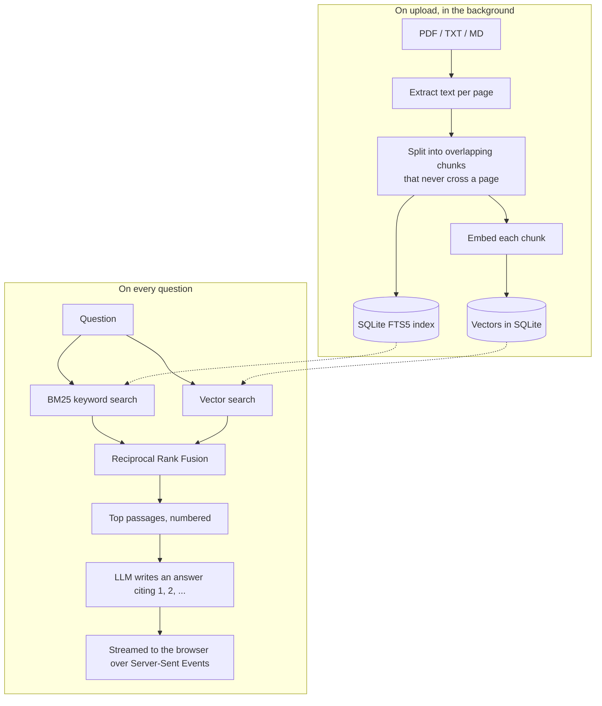

# DocMind

Ask questions about your PDFs and get answers that cite the page they came from. Click a citation and the passage opens beside the answer with the supporting lines highlighted.



**Stack:** Python · FastAPI · SQLite FTS5 · NumPy · fastembed · OpenAI-compatible LLMs · React 19 · TypeScript · Tailwind CSS v4 · TanStack Query · Docker · GitHub Actions

## What it does

- **Upload PDFs, text or Markdown.** Files are processed in the background; the library shows progress and explains failures in plain words (password-protected, scanned without text, too many pages).
- **Hybrid search.** Every question runs a keyword search (BM25) and a semantic vector search, then merges the two rankings.
- **Streamed, cited answers.** Text appears as it is generated. Each claim carries a citation like a highlighter mark; clicking it opens that passage with its page number and a link to the exact page in the original PDF.
- **Follow-up questions** keep the conversation's context.
- **Choose what to search.** Untick documents in the library to leave them out.
- **Works without an API key.** With no model connected, DocMind runs in *quote mode* and answers with the most relevant sentences from your documents, still cited. Connect any OpenAI-compatible model to get written answers.

| Start screen | Sources on mobile |
| --- | --- |
|  |  |

## How it works



### Decisions worth explaining

**Why hybrid search?** Embeddings are good at meaning ("time off" finds "annual leave") but blur exact terms like clause numbers, product codes or names. BM25 is the opposite. Running both and merging with [Reciprocal Rank Fusion](https://plg.uwaterloo.ca/~gvcormac/cormacksigir09-rrf.pdf) gets the strengths of each without calibrating two incompatible score scales: a passage's score is the sum of `1 / (60 + rank)` over the lists it appears in ([`retrieval.py`](backend/app/retrieval.py)).

**Why chunks never cross pages.** Every chunk has exactly one page number, so every citation can link to the right page. Chunks are packed from whole sentences (about 900 characters) and start with the last sentence or two of the previous chunk, so an answer that falls on a boundary is still found ([`chunking.py`](backend/app/ingest/chunking.py)).

**Why SQLite instead of a vector database?** For a few thousand pages, a NumPy matrix multiply over cached embeddings takes milliseconds, and SQLite gives full-text search and transactions in one file with nothing extra to run. The `Retriever` sits behind a small interface, so swapping in pgvector or Qdrant later touches one class.

**Streaming over Server-Sent Events.** The server sends the numbered sources first, then tokens as they arrive. The browser can show "Reading 5 passages…" immediately and render citations the moment they appear. Because the request is a POST, the client parses the event stream itself instead of using `EventSource`.

**Prompt injection.** Passages are clearly delimited as data and the system prompt tells the model to ignore instructions inside them.

## Running it

### With Docker

```bash
docker compose up --build
```

Open http://localhost:8000 and drop in a PDF, or try [`samples/kestrel-employee-handbook.pdf`](samples/kestrel-employee-handbook.pdf). The first upload downloads a small embedding model (about 130 MB), which is cached in the Docker volume.

### Without Docker

You need Python 3.12+, [uv](https://docs.astral.sh/uv/) and Node.js 22+.

```bash
git clone https://github.com/Salmanhussain999/docmind.git
cd docmind

# API on http://localhost:8000
cd backend
uv sync --extra local
cp .env.example .env          # optional: add an LLM key, see below
uv run uvicorn app.main:create_app --factory --reload

# Web app on http://localhost:5173 (in a second terminal)
cd frontend
npm install
npm run dev
```

## Connect an AI model

DocMind talks to any OpenAI-compatible chat API. Set these in `backend/.env` (or in `.env` next to `docker-compose.yml`):

| Provider | `LLM_BASE_URL` | `LLM_API_KEY` | `LLM_MODEL` |
| --- | --- | --- | --- |
| OpenAI | *(leave empty)* | your key | e.g. `gpt-5-mini` |
| Groq (has a free tier) | `https://api.groq.com/openai/v1` | your key | a chat model from Groq's model list |
| Google Gemini | `https://generativelanguage.googleapis.com/v1beta/openai/` | your key | a Gemini model id |
| Ollama (runs locally) | `http://localhost:11434/v1` | *(leave empty)* | a model you've pulled |

Embeddings run locally by default (`BAAI/bge-small-en-v1.5` on the CPU), so documents are never sent anywhere just to be indexed. To use an embeddings API instead, set `EMBEDDING_PROVIDER=openai` and `EMBEDDING_MODEL`.

## Tests

```bash
cd backend
uv run pytest
```

32 tests cover text extraction (with PDFs generated in the test itself), chunking, keyword and hybrid retrieval, the upload pipeline including failure cases, the streaming chat endpoint, and the real OpenAI SDK streaming against a mocked HTTP server. CI also runs Ruff and builds the frontend.

## API

| Method | Route | Description |
| --- | --- | --- |
| GET | `/api/health` | Answer mode (LLM or quote mode) and model names |
| GET | `/api/documents` | Library, newest first |
| POST | `/api/documents` | Upload a file (`multipart/form-data`, field `file`); processing continues in the background |
| GET | `/api/documents/{id}` | One document, including status and any error |
| GET | `/api/documents/{id}/file` | The original file, inline (append `#page=N` to open a page) |
| DELETE | `/api/documents/{id}` | Remove a document and its index entries |
| POST | `/api/chat` | `{question, document_ids?, history?}` → Server-Sent Events: `sources`, `token`…, `done` (or `error`) |

Interactive docs are at `/docs` while the server runs.

## Project structure

```
backend/
  app/
    ingest/        text extraction and chunking
    routes/        documents and chat endpoints
    embeddings.py  local, OpenAI-compatible and test embedders
    retrieval.py   vector index, BM25 search, rank fusion
    llm.py         prompt, OpenAI-compatible streaming, quote-mode fallback
    ingestion.py   background pipeline
  tests/
frontend/
  src/
    components/    Library, Chat, Answer, Sources
    hooks/         documents and chat state
    lib/           API client and SSE parser, highlighting helpers
samples/           a sample handbook PDF and the script that makes it
```

## Limitations and next steps

- Scanned PDFs need OCR first; DocMind only reads PDFs that contain real text.
- It is single-user: there are no accounts, so run it locally or behind your own login.
- Short follow-up questions borrow the previous question for retrieval. Asking the model to rewrite them as standalone questions would retrieve better, at the cost of one more call.
- A reranking model over the fused results would improve precision further.

## License

MIT
